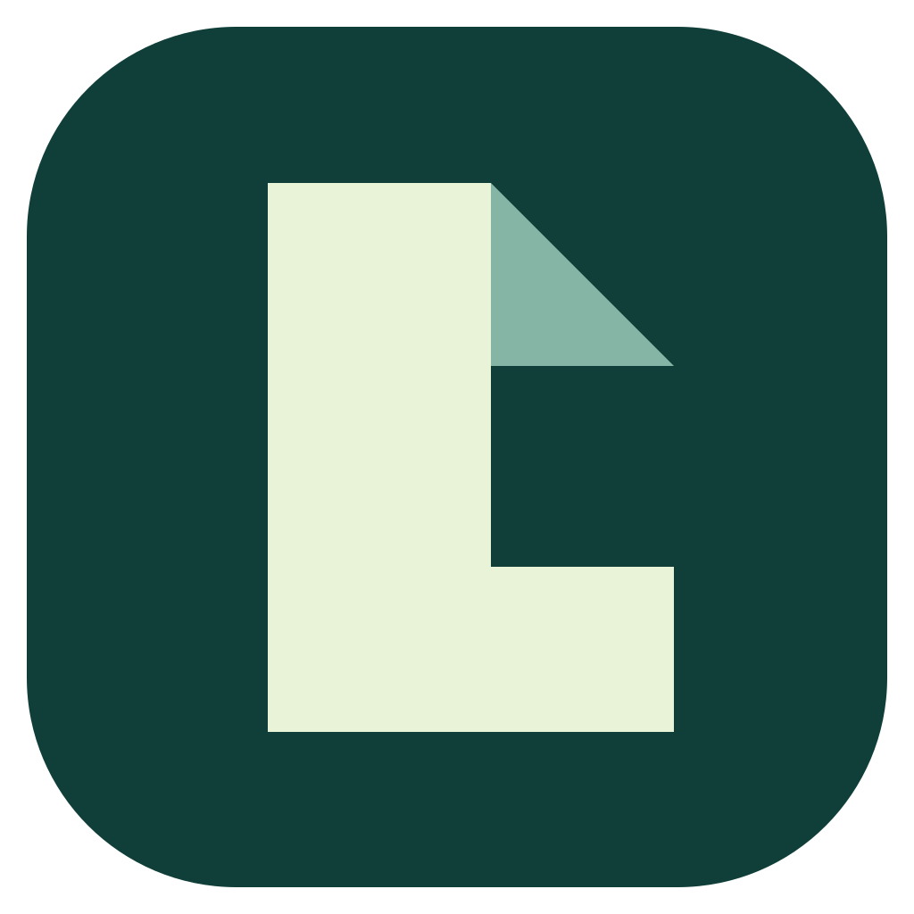
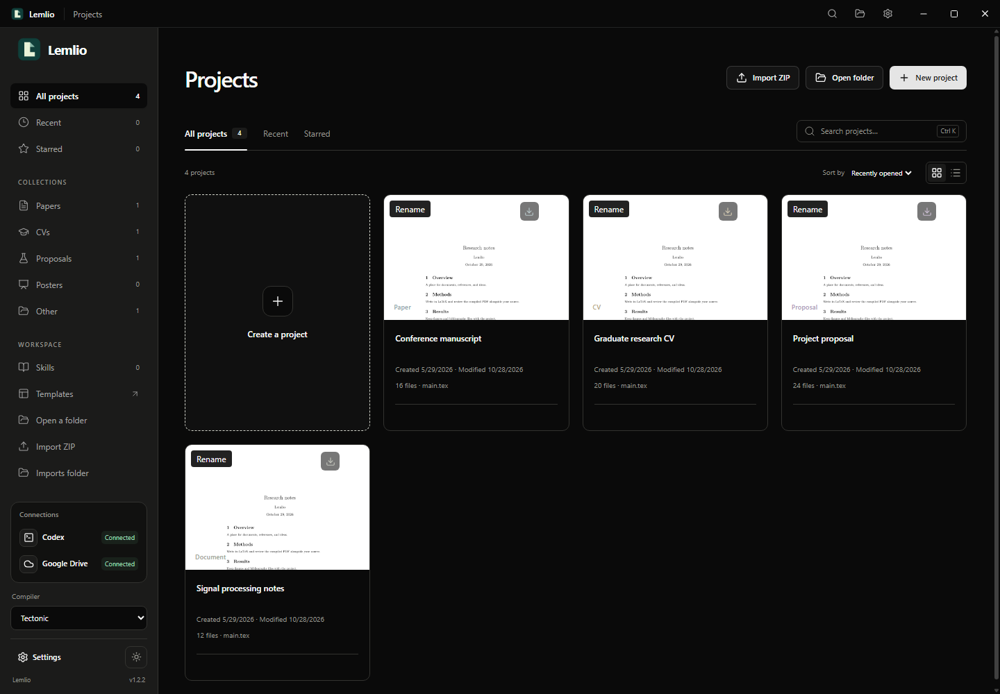
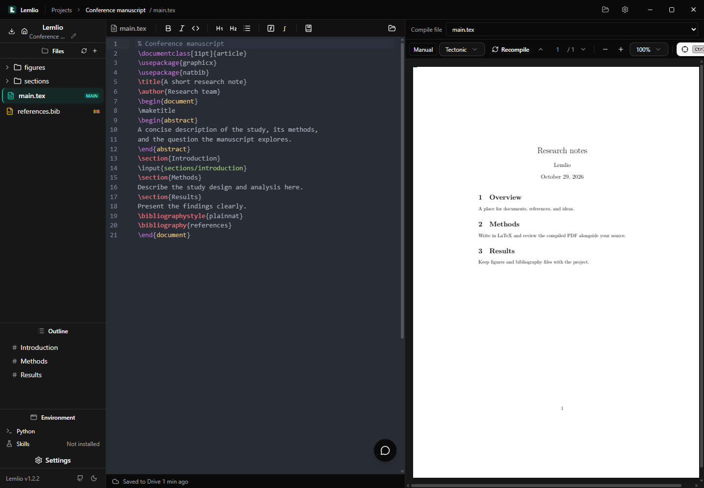
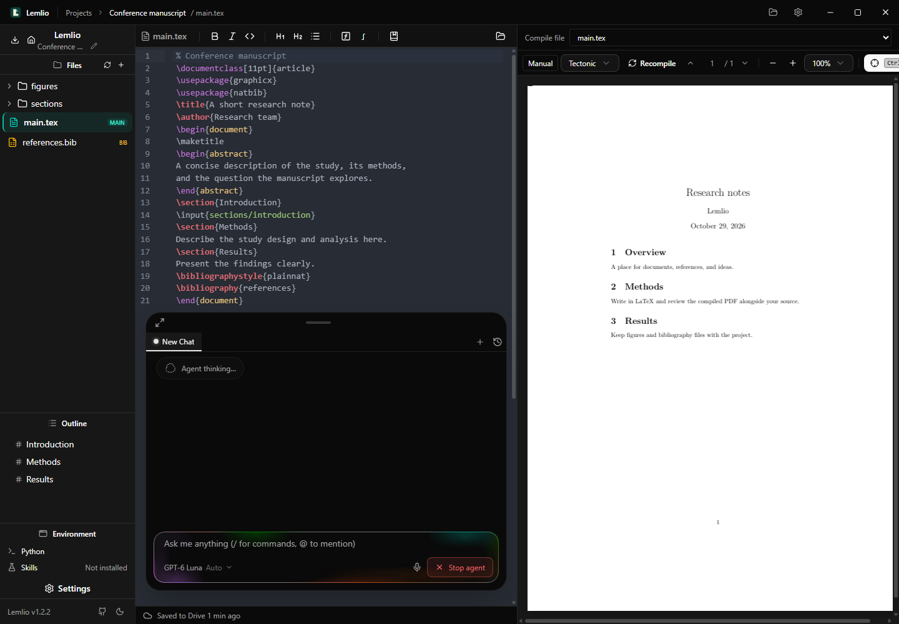
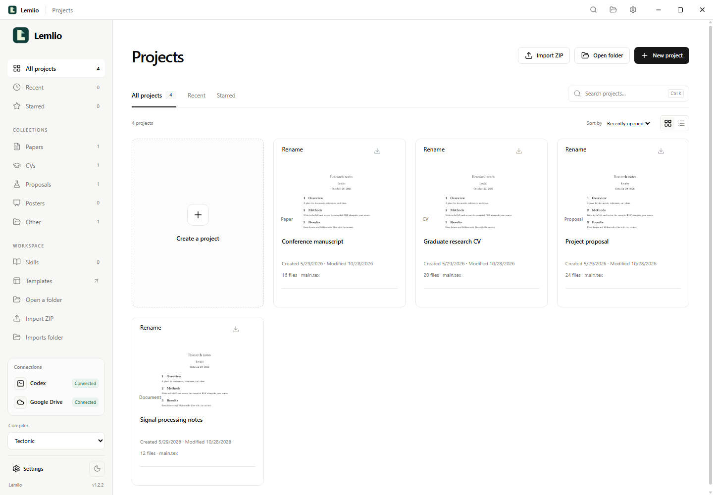
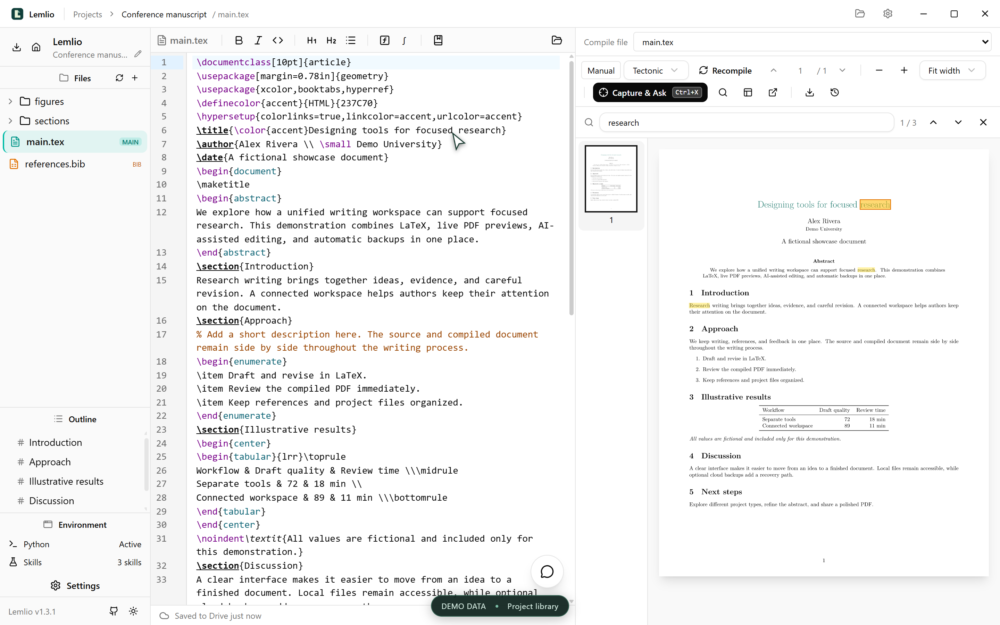
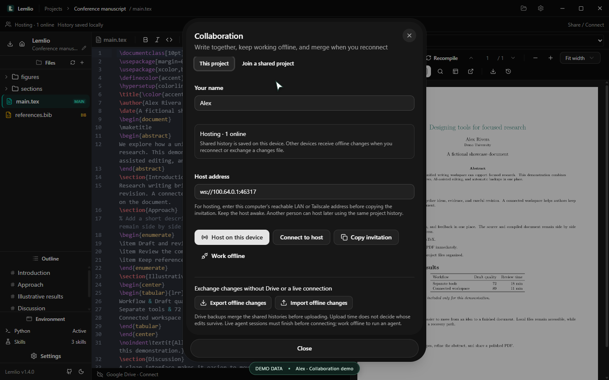

<p align="center">
  
</p>

<h1 align="center">Lemlio</h1>

<p align="center">
  LaTeX projects, PDF previews, and Codex on your desktop.<br />
  Write locally. Compile side by side. Back up to your Dropbox.
</p>

<p align="center">
  <a href="https://github.com/samanjoy2/lemlio/releases/tag/lemlio-v1.4.0"></a>
  <a href="https://github.com/samanjoy2/lemlio/releases/latest"></a>
  <a href="https://github.com/samanjoy2/lemlio/releases/latest"></a>
  
  <a href="LICENSE"></a>
</p>

<p align="center">
  <a href="#download-and-install"><strong>Download Lemlio</strong></a>
  · <a href="#what-you-can-do">Features</a>
  · <a href="#a-look-inside">Screenshots</a>
  · <a href="#collaboration">Collaboration</a>
  · <a href="#dropbox-backup">Dropbox backup</a>
  · <a href="#build-from-source">Build from source</a>
</p>



Lemlio brings your LaTeX projects into a searchable library with PDF covers, an editor beside the compiled document, and Codex chat when you need help. Open an existing folder or import a project ZIP, keep working with ordinary local files, and optionally back up and sync saved revisions through your own Dropbox folder.

**A fresh installation starts empty.** Your documents and account connections are not bundled with the app. Tectonic and Latin Modern fonts are included, with Tectonic selected by default; Codex, the Dropbox backup folder, and MiKTeX can be configured later.

## What you can do

| Feature | In Lemlio |
| --- | --- |
| **Browse your projects** | PDF thumbnails, search, favorites, recent projects, and grid or list views. Failed previews use a document fallback. |
| **Keep projects organized** | Clone projects, rename titles, see creation and modification dates, or delete a project to the system Trash or Recycle Bin with confirmation. Use the project menu or right-click for actions. |
| **Write beside your PDF** | LaTeX editing, document outline, source navigation, a visible main-file selector, and a high-resolution PDF reader with text selection, links, search, page thumbnails, and fit-to-width zoom. |
| **Work with Codex** | Use your Codex sign-in, stream replies, choose a named model, review approval requests, and return to saved chats. GPT-6 Luna is the default model. |
| **See what is happening** | A centered orb for first compilation and a compact indicator on recompilation, a breathing **Agent thinking…** pill, colorful chat borders, and an explicit **Stop agent** button. |
| **Choose when to compile** | Switch between **Auto** and **Manual**. Use bundled Tectonic or select an optional MiKTeX / TeX Live installation. |
| **Move projects easily** | Import and export ZIPs with nested source folders, figures, and bibliography files. Keep the original ZIP or choose to move it. |
| **Write together** | Live shared text, colored cursors, local offline history, encrypted offline change files, and hosting from either collaborator’s computer. |
| **Sync between devices** | Connect Dropbox once. Five-minute checks, notifications for projects found only in the backup, automatic incoming revisions for closed unchanged projects (the same project is updated in place, never duplicated), and protected conflict review. |
| **Check your backup status** | See Codex, backup, and Voice status on the home page, and this project's confirmed backup age in the editor. |
| **Use your existing tools** | Open the project folder, continue in an installed VS Code editor, and browse your installed Codex research skills. |

## Download and install

Lemlio **1.4.0** includes a **Windows x64 installer** and **macOS disk images for Apple Silicon and Intel**.

1. Open the [latest GitHub release](https://github.com/samanjoy2/lemlio/releases/latest).
2. Under **Assets**, download `Lemlio_1.4.0_x64-setup.exe`. GitHub's source-code ZIP is for development.
3. Close an older running copy of Lemlio or PrismPro, then run the installer.
4. Open Lemlio and create a project, open a folder, or select **Import ZIP**.

On macOS, choose the **AppleSilicon** image for an M-series Mac or **Intel** for an Intel Mac. Open the DMG and drag Lemlio into Applications. Tectonic and Latin Modern fonts are included; Homebrew is not required. The Mac app is ad hoc signed and is **not Apple notarized**. macOS may require approval in **System Settings → Privacy & Security** after an initial launch attempt.

The release also includes `Lemlio-1.4.0-SHA256SUMS.txt`. To compare your download with its published checksum:

```powershell
Get-FileHash .\Lemlio_1.4.0_x64-setup.exe -Algorithm SHA256
```

The installer is currently unsigned, so Windows may identify its publisher as unknown. Releases and installers are available publicly on GitHub.

### Updating

Close Lemlio and run the newer Windows setup. The installer detects the existing installation; choose to continue without uninstalling to update in place. On macOS, replace the older copy in Applications. Projects, saved settings, and your backup folder setting are retained. **Settings → About → Check for updates** shows the installed and latest versions, then offers the correct installer for your computer. Downloads open in the browser; run the installer or replace the Mac app after closing Lemlio. Earlier versions can use their **Download latest update** link.

### First launch

The first-run **Settings & setup** screen can be closed and reopened later. Editing and compilation do not require an AI or cloud account.

| Optional setup | Where to find it |
| --- | --- |
| **Codex** | **Settings → Codex**: connect your Codex account and choose a model. Available models depend on your account. |
| **Backup** | Click the backup status on the home page or editor, or open **Settings → Backup** and press **Connect Dropbox**. A synced folder is available under Advanced. |
| **MiKTeX / TeX Live** | **Settings → Compiler**: install MiKTeX using the provided link, then select the system compiler. Tectonic remains the fresh-install default. |
| **Appearance and skills** | **Settings → General** and **Settings → Skills**. Version and source information are under **About**. |

Codex uses your account's allowance; Lemlio does not include an AI subscription. See [Codex pricing and usage](https://learn.chatgpt.com/docs/pricing) for account-specific details. Tectonic may download TeX packages during compilation. Some documents need additional fonts, packages, or a system compiler.

## Voice prompts and main documents

Click the microphone in Codex chat to dictate with Windows speech recognition. A colorful glow responds to the microphone; words go into the editable prompt and are sent only when you press Send. Stop with the square button or close the chat. Windows needs an installed speech recognizer and microphone permission. **Settings → Voice** explains how to install a speech language. No extra OpenAI API key is required; recognition is unavailable until that Windows component is installed.

On macOS, use the system Dictation shortcut in the prompt. The microphone button opens Voice setup; the Windows speech recorder is Windows-only.

The tree marks the compile target **MAIN**, colors LaTeX files teal and bibliography files amber, and offers **Use as main compile file**. The PDF panel also has a **Compile file** dropdown. Lemlio remembers your choice per project; opening another complete document switches the target, while a bibliography, figure, or included chapter keeps the current PDF.

## A look inside

### Write beside your PDF



The PDF reader supports selectable text and links, **Find in PDF** (Ctrl/Cmd+F), match navigation, page thumbnails, page jumping, zoom, and fit-to-width/height. **Open PDF in system reader** gives access to native printing. Double-click selects words; Ctrl/Cmd-click text or Alt-double-click the page navigates to source. Controls wrap as the panel narrows, and recompiling keeps the last PDF clear. Scanned image-only PDFs need OCR before their text can be searched or selected.

The file tree identifies the main document and bibliography; the PDF stays visible while you browse related files. The header keeps project navigation, folder access, settings, and window controls together.

### Codex chat



One compact indicator shows agent activity. The microphone inserts editable prompt text, and **Stop agent** is always visible while the agent works.

<details>
<summary><strong>Light mode</strong></summary>





</details>

Screenshots show the current interface with generated demonstration documents and simulated connection/agent states. See the [verification report](docs/VERIFICATION-1.4.0.md) for checks and practical limits.

## Import, export, and local files

**Import ZIP** accepts ordinary LaTeX project archives, including compatible exports from Prism. It preserves nested files and binary figures. Importing the same project again creates a separate folder rather than overwriting an existing one.

| Action | What happens |
| --- | --- |
| **Clone project** | Creates an independent library project from an existing project. Source, figures and bibliography are copied; caches, Git internals and backup identity are excluded, so a clone is a separate project with its own backup history. |
| **Copy project** | Extracts and registers the project while keeping the original ZIP in place. |
| **Move ZIP** | Imports the project, verifies the saved archive, then moves the original ZIP into the app's `Projects/Archives` folder. A failed move keeps the original and reports the problem. |
| **Open a folder** | Works with the folder you select. Your project files stay there. |
| **Export project ZIP** | Saves open edits first, then includes source files, assets, and empty folders. App caches, Git metadata, app history, virtual environments, and `node_modules` are excluded. |

You can also place a LaTeX project folder directly inside **Imports**. Each immediate subfolder containing LaTeX sources is discovered automatically, including nested main documents. Use **Imports folder** on the home page to open the location. The folder is created during installation and startup; the library refreshes every 10 seconds and when it regains focus. Discovered projects enter the automatic backup queue when a backup folder is chosen.

Imported projects live under:

```text
%LOCALAPPDATA%\Lemlio\Projects\Imports
```

Project dates come from local filesystem timestamps. PDF covers are cached on disk: the first visit uses an existing matching PDF or attempts one preview compilation. Reopening the library reuses the saved cover. Compiling the project refreshes it; a failed compilation records a document fallback.

Collections are predefined: Papers, CVs, Proposals, Posters, and Other. Classification uses the original folder/project name and sometimes the main filename. Renaming the displayed project title does not recategorize it. Custom collections and manual category editing are not available yet.

## Codex compilation and PDF checks

New Codex chats include `lemlio_compile` and `lemlio_view_pdf_page`. The first runs the same compiler pipeline as the editor, using its selected main file and compiler, and returns actual success, errors, and available warning messages. The second sends a rendered page of the last successful agent compilation to Codex for visual inspection. It supports page selection; old previews are not treated as proof of a successful new compile.

The default compiler is bundled Tectonic, including Lemlio's fonts, project staging, and compatibility fixes. The optional system compiler is used only when selected in Settings. Dirty editor changes and concurrent compilation are protected. The host limits these tools to the chat's currently open project.

**After upgrading, start a new chat once to get the direct tools.** Existing chats that already have the tools retain them on resume. Older chats receive an explicit terminal fallback to the installed Lemlio executable; the bundled Tectonic directory is also included in the Codex process PATH. No separate OpenAI API key or Tectonic installation is needed for these tools. A successful compile verifies compilation, while visual layout claims require viewing the rendered PDF.

## Related project versions (next update)

**Project groups** opens a membership manager in the library and editor. Create a named group, choose projects, then select **Open workspace**. The group gets its own full workspace with saved PDF covers, scrollable project tabs, the normal editor and PDF reader, the same Codex composer used in normal chat (colours, microphone, attachments, model and stop controls), and a separate review view. Tab switches save local edits first; a failed save keeps the current version open. Group definitions are stored on this device. Membership stays manual: clones are independent and are not silently added to groups. To update related CVs, enter one common request and choose **Update all versions**. The agent can edit those selected folders while preserving their individual differences; saving a group alone never modifies files.

Each run creates per-project history checkpoints. After the agent finishes (or you stop it), use **Review changes** to see changed files and before/after text for every project together. Binary files are listed without a visual diff. Older checkpoints remain in each project's History; a new run replaces the combined review baseline. Review includes all changes since the checkpoint, including any manual edits made afterward.

Group runs support 2–20 local projects, including projects with shared history. A live session pauses for the group edit; shared history is updated afterward, including partial edits when stopped. Reconnect after reviewing. Finish other editors' work first. The normal Codex approval flow still applies. Integrated compiler/PDF tools target the open project; Codex receives terminal compiler instructions for the other variants. This is a manual batch edit, not automatic shared-component synchronization. Newly cloned projects appear first and clear library filters. Right-click a tab or preview to mention that project in chat, set it as the main reference, or remove it from the group without deleting files. Drag tabs or previews to save a custom order; the main-version marker remains independent of placement. In the editor, the file sidebar extends to the bottom beside the group composer.

## Collaboration

Open a project → **Collaborate → Enable collaboration → Host on this device**. Copy its invitation and send it privately. The other person chooses **Join shared project** on the home page and pastes it. Both people keep a local copy and can edit or host. Everyone needs Lemlio **1.4.0 or later**.



No paid hosting service or Node installation is required. On the same network, use the host’s LAN address. Across the internet, connect the computers through a reachable private network such as [Tailscale](https://tailscale.com/pricing), then put the host’s private address into the invitation. Tailscale currently offers a free Personal plan; its usage terms apply. Lemlio does not provide a public collaboration server or automatic internet routing.

Text changes merge through [Yjs](https://docs.yjs.dev/). A collaborator can keep editing without internet or Drive, then reconnect or send an encrypted `.lemlio-changes` file. Upload time does not choose a winning document. Concurrent file replacements, renames, and deletion-versus-edit conflicts require review. Either person can host the next session; closing the host ends the live connection, while local editing continues.

See the [collaboration guide](docs/COLLABORATION.md) for host handoff, offline exchange, Drive backup behavior, privacy, and limits. This first version supports 16 MB of shared source/assets, 96 MB of history, and 12 connections per host. Everyone with an invitation is an editor. Use **Work offline** before running Codex on a shared project.

## Dropbox backup

The home page shows **Cloud backup** with a connection prompt beside the Codex status. Click it to open setup. Inside a project, the editor shows **Saved to backup … ago**, **Backup pending**, **Saving backup…**, or a failure that will retry. The timestamp belongs to that project and is recorded after the ZIP is written and verified in your backup folder.

### Connect Dropbox once

1. Open **Settings → Backup** and press **Connect Dropbox**. Your browser opens Dropbox, where you approve access to a single app folder (Apps → Lemlio). Lemlio never sees your password and cannot see the rest of your Dropbox.
2. Do the same on every computer, with the same Dropbox account.

If your browser cannot return to Lemlio, choose **Use a code instead**: Dropbox shows a short code that you paste into Lemlio.

Only a refresh token is kept, in Windows Credential Manager or the macOS Keychain, never in project folders, logs or backups. **Disconnect** signs out at Dropbox and forgets the token; your backups stay in Dropbox. Releases that include a Dropbox app key work immediately; for a build without one, create a Dropbox app and enter its key under **Advanced** (see [Dropbox setup](docs/DROPBOX-SETUP.md)).

**Advanced: synced folder.** If you prefer no sign-in at all, choose a folder inside your Dropbox (or OneDrive) folder instead. Lemlio writes a **Lemlio Backups** folder there and the sync app does the uploading, so it also works fully offline.

Dropbox storage is your own (the free plan includes 2 GB) and every backup adds a revision, so keep an eye on usage for large projects.

### What happens automatically

- **Local saving:** edited files save after a two-second pause in typing.
- **Backup:** with automatic backup enabled, saved changes are written to your backup folder after about 15 seconds. Newly imported projects queue too.
- **Discovery:** revision checks run every five minutes while Lemlio is open. New projects found only in the backup produce a notice with **Review and download**. Nothing is pulled until you choose it. A local project with the same title but no backup identity is never downloaded as a duplicate: you are offered **Link to my project** instead.
- **Retries:** pending jobs are checked every minute while Lemlio is open. The queue survives app restarts, and a Dropbox folder that is temporarily unavailable simply retries later.
- **Versioned ZIP snapshots:** changed projects create immutable ZIP revisions inside **Lemlio Backups**. Every ZIP includes `.lemlio-sync.json` with the project identity, parent revisions, content hash, device identity, saved title, and save time. The revision graph detects simultaneous saves without overwriting either upload. Unchanged content is skipped. Older revisions remain in Drive and use your storage; there is no automatic history pruning.
- **Incoming changes:** if another updated device saves a project and this device has not edited its last synced source, a closed project downloads and verifies the newer revision automatically. An open project shows **Update from [device] · Review**. **Get latest revision** checks for unsaved edits, compilation, and active agents before closing/reopening that editor. The previous local source is kept in a hidden `.lemlio-recovery-*` sibling folder; local Git repositories, environments, and app caches stay with the working project.
- **Conflicts:** if both devices edited, an uploaded ZIP was modified externally, or two devices saved competing revisions, neither version silently wins. Review device and time details, choose a Drive revision if several exist, then choose the PC source or download the selected Drive source into a new folder. **Pause uploads only** does not download anything. For ordinary projects, this is project-level conflict resolution. Shared projects instead merge their verified collaboration histories before backup and ask you to review file conflicts.
- **Renaming:** saving a project title in Lemlio queues an update to its Drive ZIP name, even if the document files are unchanged. Renaming the ZIP directly in Drive keeps its identity and is preserved by ordinary backups. Lemlio title changes travel with incoming revisions. A filename edited directly in Drive is separate from the saved project title.
- **Status:** the home page summarizes every project's backup, including pending, failed, and conflicting projects. The editor shows the open project's confirmed backup age.
- **Reset:** Settings → Backup can rename the old **Lemlio Backups** folder (for example to **Lemlio Backups (reset 20260101-120000)**) and start fresh. Nothing is deleted.
- **New computer or recovery:** install Dropbox, choose the same folder in Settings → Backup and select **Restore projects from backup**. Select backups and restore them into new local project folders. Restored projects keep their backup identity, so their next backup continues the same history.

### Moving to a new computer

Install Lemlio, press **Connect Dropbox** in **Settings → Backup** with the **same Dropbox account**, then select **Restore projects from backup**, choose your projects, and restore. Nothing is downloaded merely by connecting. If a project of the same title already exists on the new computer, use **Link to my project** instead of restoring: it becomes the same project, and newer backup revisions replace it in place with the previous files kept in a recovery folder. After restoration, edit the local copies normally; they become the source for future backups. On subsequent starts, unchanged closed projects receive newer revisions automatically. If both computers edited, review the versions first.

### Closing safely

When you close Lemlio, it saves open edits and checks every project against Drive. The dialog shows confirmed backups, pending uploads, or conflicts and offers **Back up and close**. **Do not ask again when everything is backed up** skips the dialog only after all projects are verified and no compilation or agent is active. You can change this preference in Settings → General. Pending, disconnected, conflicting, or unsaved work still requires attention.

Automatic backup is enabled by default, but requires a chosen backup folder and Lemlio to be running. This is a desktop backup workflow; live collaboration uses the desktop app, and there is no background upload service after the app closes. Changes that have not reached your backup folder are not protected against loss of the PC.

Backups use your Dropbox storage. Editing always works offline; backups upload when Lemlio is online and retry otherwise.

### Fonts and EPS figures

The Windows and macOS releases include Latin Modern 2.005 under the GUST Font License. Bundled Tectonic can find these fonts and installed Windows fonts without modifying the system font installation. If Ghostscript or MiKTeX's converter is already installed, Lemlio converts EPS figures to PDF in the staged build copy; originals remain unchanged. EPS projects on PCs without a converter require Ghostscript or PDF versions of those figures. Tectonic remains the compiler.

## Privacy and storage

| Data | Where it goes |
| --- | --- |
| **Documents, figures, PDFs, and history** | Stay in local project folders and app-managed files. |
| **Codex requests** | Prompts and files used by the agent are sent to the configured model provider. |
| **Backups** | Project ZIPs are stored in the Lemlio app folder of your own Dropbox (or in a synced folder you choose). |
| **Dropbox sign-in** | Only a refresh token, in Windows Credential Manager or the macOS Keychain. No password is ever seen. The synced-folder path is saved in local settings. |
| **Project identity** | Each project folder holds a small `.lemlio-project.json` with a random id so every computer recognizes the same project. Clones and imported ZIPs get their own id. |
| **Installer and source repository** | Exclude personal projects, local build tools, and saved credentials. |

Project exports exclude `Keys/` and recognized credential filenames. Keep other sensitive files outside projects you export or back up.

## Build from source

Development requires **Node.js 22+**, **pnpm 11.25.0**, Rust, and the platform's Tauri prerequisites. Windows builds need Visual Studio C++ Build Tools and WebView2. Installed users do not need Node.js, pnpm, or Rust.

```powershell
git clone https://github.com/samanjoy2/lemlio.git
cd lemlio
pnpm install --frozen-lockfile
powershell -ExecutionPolicy Bypass -File scripts/prepare-windows.ps1
pnpm --filter @prismpro/desktop tauri build --bundles nsis
```

The preparation script downloads and checks the official Windows Tectonic binary. The installer is written under `apps/desktop/src-tauri/target/release/bundle/nsis`.

On a Mac with Xcode command-line tools, Node, pnpm, and Rust:

```bash
pnpm install --frozen-lockfile
bash scripts/prepare-macos.sh
pnpm --filter @prismpro/desktop tauri build --bundles app,dmg
```

This produces a native disk image for the Mac's architecture under `apps/desktop/src-tauri/target/release/bundle/dmg`.

Useful checks:

```powershell
pnpm exec biome ci
pnpm --filter @prismpro/desktop build
pnpm --filter @prismpro/desktop test
cargo test --release --lib --manifest-path apps/desktop/src-tauri/Cargo.toml
```

The internal workspace package remains `@prismpro/desktop`. Windows and macOS releases are built natively. Separate GitHub workflows build Windows and both Mac architectures; macOS packaging verifies signing, bundled dependencies, and a real Tectonic font compilation.

### Project layout

```text
apps/desktop/src/             React editor, project library, settings, and chat
apps/desktop/src-tauri/src/   Rust backend, compilation, ZIP transfers, folder-based backups
assets/                      Lemlio icon and demonstration screenshots
scripts/                     Windows/macOS build preparation and development checks
examples/                    Starter LaTeX project
releases/                    Local release output; ignored by Git
```

## Releases and help

- [Latest installer](https://github.com/samanjoy2/lemlio/releases/latest)
- [All releases](https://github.com/samanjoy2/lemlio/releases)
- [Source code](https://github.com/samanjoy2/lemlio)
- [Report a bug or request a feature](https://github.com/samanjoy2/lemlio/issues)

For a bug report, include your Lemlio version, compiler choice, and steps to reproduce with a small sample project. Remove private document content and account credentials from any files or screenshots you share.

## Credits and license

Lemlio builds on [Claude Prism by delibae](https://github.com/delibae/claude-prism), with substantial changes to Codex integration, project management, compilation, ZIP transfers, and the interface. Original MIT copyright notices are retained in [LICENSE](LICENSE).

Loading animations use [thinking-orbs](https://libraries.dev/orbs); chat effects use [Border Beam](https://libraries.dev/beam) and [Voice Glow](https://libraries.dev/voice). The VS Code icon comes from [Microsoft's VS Code repository](https://github.com/microsoft/vscode). Collaboration uses Yjs, y-protocols, and y-codemirror.next (MIT). Third-party projects retain their own licenses.

Interface refinement follows the [unslop](https://heydamir.design/unslop) craft guidelines by Damir Sokolovsky ([@heydamir](https://x.com/heydamir)), licensed CC BY 4.0.

PanelUI web components are used for shared controls, settings tabs, cloning dialogs and project/Drive surfaces. See [third-party notices](THIRD_PARTY_NOTICES.md) for the MIT attribution.


## Choosing your AI assistant: Codex or Claude

Lemlio works with either local CLI. Open **Settings → Assistant** and pick **Codex (OpenAI)** or **Claude (Anthropic)**.

- Codex: `npm install -g @openai/codex`, then sign in with ChatGPT.
- Claude: `npm install -g @anthropic-ai/claude-code`, then sign in with `claude auth login` (or the button in Settings).

Each provider remembers its own model. Defaults are the cheapest options: GPT-6 Luna for Codex and Claude Haiku for Claude. Set `CLAUDE_BINARY` / `CODEX_BINARY` if the executable is not on your PATH.
