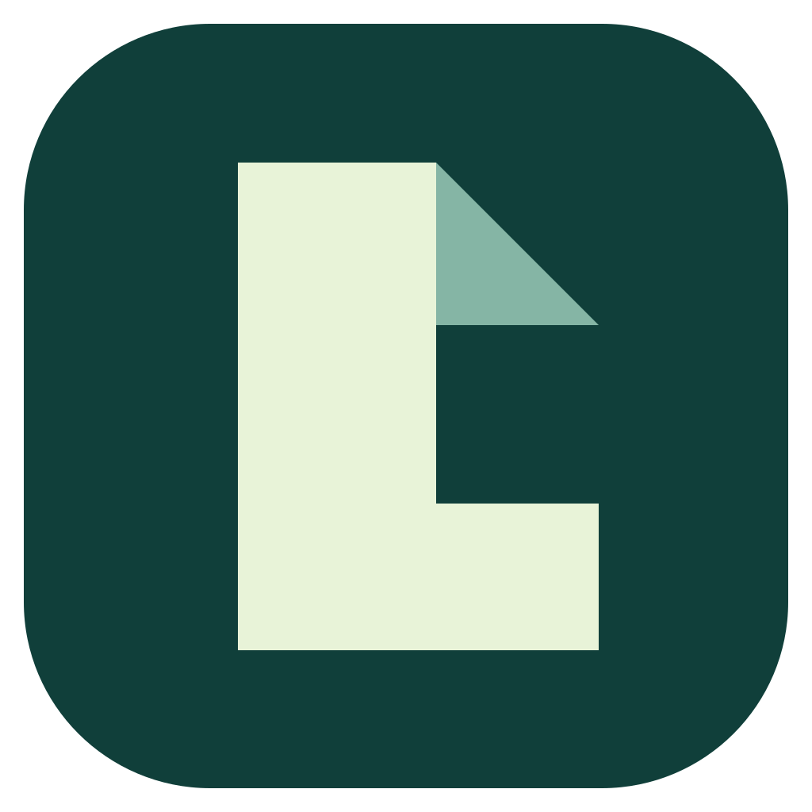
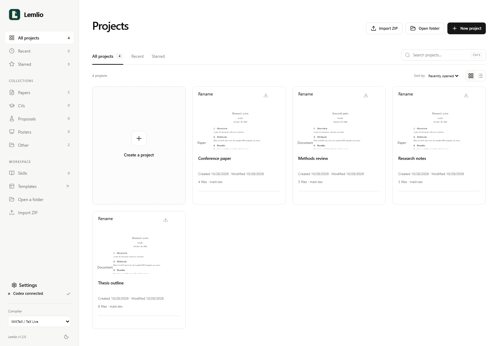
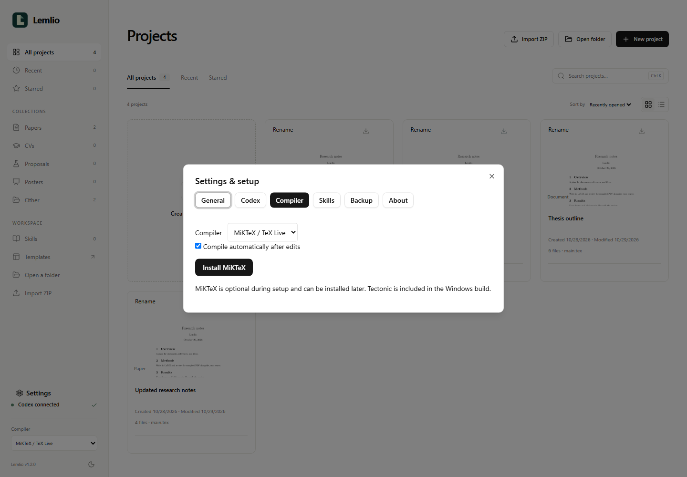
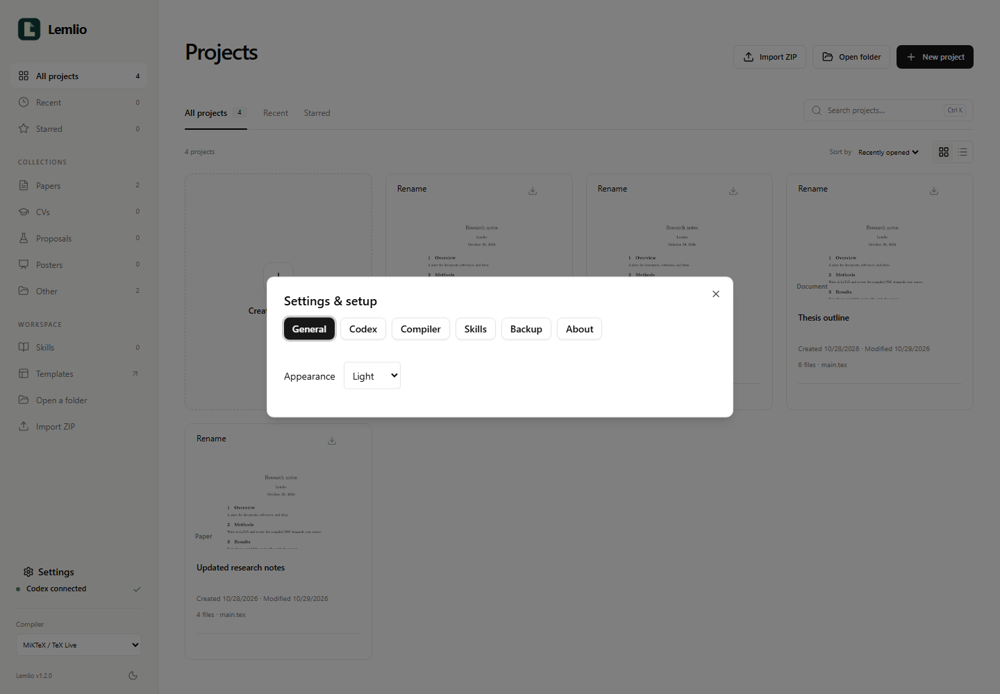

<p align="center">
  
</p>

<h1 align="center">Lemlio</h1>

<p align="center">
  LaTeX projects, PDF previews, and Codex on your desktop.<br />
  Write locally. Compile side by side. Back up to your Google Drive.
</p>

<p align="center">
  <a href="https://github.com/samanjoy2/lemlio/releases/tag/lemlio-v1.2.1"></a>
  <a href="https://github.com/samanjoy2/lemlio/releases/latest"></a>
  
  <a href="LICENSE"></a>
</p>

<p align="center">
  <a href="#download-and-install"><strong>Download for Windows</strong></a>
  · <a href="#what-you-can-do">Features</a>
  · <a href="#a-look-inside">Screenshots</a>
  · <a href="#google-drive-backup">Google Drive</a>
  · <a href="#build-from-source">Build from source</a>
</p>



Lemlio brings your LaTeX projects into a searchable library with PDF covers, an editor beside the compiled document, and Codex chat when you need help. Open an existing folder or import a project ZIP, keep working with ordinary local files, and optionally save automatic backups to your own Google Drive.

**A fresh installation starts empty.** Your documents, account connections, and Google OAuth JSON are not bundled with the app. Tectonic is included and selected by default; Codex, Google Drive, and MiKTeX can be configured later.

## What you can do

| Feature | In Lemlio |
| --- | --- |
| **Browse your projects** | PDF thumbnails, search, favorites, recent projects, and grid or list views. Failed previews use a document fallback. |
| **Keep projects organized** | Rename project titles and see creation and last-modified dates without changing the underlying folder paths. |
| **Write beside your PDF** | LaTeX editing, document outline, source navigation, and a resizable PDF preview. |
| **Work with Codex** | Use your Codex sign-in, stream replies, choose a named model, review approval requests, and return to saved chats. GPT-6 Luna is the default model. |
| **See what is happening** | A centered compilation orb, visible agent activity, and an explicit **Stop agent** button. |
| **Choose when to compile** | Switch between **Auto** and **Manual**. Use bundled Tectonic or select an optional MiKTeX / TeX Live installation. |
| **Move projects easily** | Import and export ZIPs with nested source folders, figures, and bibliography files. Keep the original ZIP or choose to move it. |
| **Back up automatically** | Connect Google Drive once. Saved edits and newly imported projects queue for backup, with failed jobs retained for retry. |
| **Check your backup status** | See Drive connection status beside Codex on the home page, and this project's confirmed backup age in the editor. |
| **Use your existing tools** | Open the project folder, continue in an installed VS Code editor, and browse your installed Codex research skills. |

## Download and install

Lemlio **1.2.1** is available as a **Windows x64 installer**.

1. Open the [latest GitHub release](https://github.com/samanjoy2/lemlio/releases/latest).
2. Under **Assets**, download `Lemlio_1.2.1_x64-setup.exe`. GitHub's source-code ZIP is for development.
3. Close an older running copy of Lemlio or PrismPro, then run the installer.
4. Open Lemlio and create a project, open a folder, or select **Import ZIP**.

The release also includes `Lemlio-1.2.1-SHA256SUMS.txt`. To compare your download with its published checksum:

```powershell
Get-FileHash .\Lemlio_1.2.1_x64-setup.exe -Algorithm SHA256
```

The installer is currently unsigned, so Windows may identify its publisher as unknown. This repository is private; viewing releases and downloading assets requires repository access.

### First launch

The first-run **Settings & setup** screen can be closed and reopened later. Editing and compilation do not require an AI or Google account.

| Optional setup | Where to find it |
| --- | --- |
| **Codex** | **Settings → Codex**: connect your Codex account and choose a model. Available models depend on your account. |
| **Google Drive** | Click the Drive status on the home page or editor, or open **Settings → Google Drive**. Choose your own Desktop OAuth JSON and connect your account. |
| **MiKTeX / TeX Live** | **Settings → Compiler**: install MiKTeX using the provided link, then select the system compiler. Tectonic remains the fresh-install default. |
| **Appearance and skills** | **Settings → General** and **Settings → Skills**. Version and source information are under **About**. |

Codex uses your account's allowance; Lemlio does not include an AI subscription. See [Codex pricing and usage](https://learn.chatgpt.com/docs/pricing) for account-specific details. Tectonic may download TeX packages during compilation. Some documents need additional fonts, packages, or a system compiler.

## A look inside

| Project library | Compiler settings |
| --- | --- |
|  |  |
| Search, star, rename, and open projects from one place. | Choose a compiler and turn automatic compilation on or off. |



Screenshots use demonstration documents. The library and settings captures predate the Google Drive status indicators added in 1.2.1.

## Import, export, and local files

**Import ZIP** accepts ordinary LaTeX project archives, including compatible exports from Prism. It preserves nested files and binary figures. Importing the same project again creates a separate folder rather than overwriting an existing one.

| Action | What happens |
| --- | --- |
| **Copy project** | Extracts and registers the project while keeping the original ZIP in place. |
| **Move ZIP** | Imports the project, verifies the saved archive, then moves the original ZIP into the app's `Projects/Archives` folder. A failed move keeps the original and reports the problem. |
| **Open a folder** | Works with the folder you select. Your project files stay there. |
| **Export project ZIP** | Saves open edits first, then includes source files, assets, and empty folders. App caches, Git metadata, app history, virtual environments, and `node_modules` are excluded. |

Imported projects live under:

```text
%LOCALAPPDATA%\Lemlio\Projects\Imports
```

Project dates come from local filesystem timestamps. PDF covers use an existing matching compiled PDF when available; otherwise Lemlio attempts to generate a preview. A compilation failure produces a default document cover.

## Google Drive backup

The home page shows **Google Drive connected** or a connection prompt beside the Codex status. Click it to open setup. Inside a project, the editor shows **Saved to Drive … ago**, **Drive backup pending**, **Saving to Drive…**, or a failure that will retry. The timestamp belongs to that project and is recorded after Google confirms its upload.

### Connect once

1. In Google Cloud, create a project, enable **Google Drive API**, and configure the OAuth consent screen. If the OAuth app is in Testing, add your Google account as a test user.
2. Add the non-sensitive `https://www.googleapis.com/auth/drive.file` scope.
3. Create an OAuth client with application type **Desktop app** and download its JSON.
4. In **Settings → Google Drive**, select **Choose OAuth JSON**, then **Connect Google Drive** and approve Google's sign-in.

Each installation uses the OAuth JSON you choose. Lemlio copies it into local app settings, outside your projects. Access and refresh tokens are stored in Windows Credential Manager. No personal Google credentials are shipped in the installer.

### What happens automatically

- **Local saving:** edited files save after a two-second pause in typing.
- **Drive backup:** with automatic backup enabled, saved changes queue for upload after about 15 seconds. Newly imported projects queue too.
- **Retries:** pending jobs are checked every minute while Lemlio is open. The queue survives app restarts, so failed uploads can be retried later.
- **Versioned copies:** each completed backup is a ZIP in your Drive's **Lemlio Backups** folder. Older backups stay until you remove them in Drive.
- **Restoring:** download a backup ZIP from Drive and import it into Lemlio. Manual snapshots are also available in Drive settings.

Automatic backup is enabled by default, but requires a connected Google account and Lemlio to be running. This is a desktop backup workflow; there is no live browser collaboration or background upload service after the app closes. Changes that have not reached Drive are not protected against loss of the PC.

Standard Drive API use has [no additional API charge](https://developers.google.com/workspace/drive/api/guides/limits); backup ZIPs use your Google storage. OAuth apps in Testing may require reconnection. Google Drive for desktop folder syncing is an alternative to the direct account connection.

## Privacy and storage

| Data | Where it goes |
| --- | --- |
| **Documents, figures, PDFs, and history** | Stay in local project folders and app-managed files. |
| **Codex requests** | Prompts and files used by the agent are sent to the configured model provider. |
| **Drive backups** | Project ZIPs are uploaded to your connected Google account when you enable backup. |
| **OAuth client JSON** | Copied into local app settings. Keep your original outside project folders or in `Keys/`. |
| **Google sign-in tokens** | Stored in Windows Credential Manager. |
| **Installer and source repository** | Exclude personal projects, local build tools, and saved credentials. |

Project exports exclude `Keys/` and recognized OAuth-client configuration filenames. Keep other sensitive files outside projects you export or back up.

## Build from source

Development requires **Node.js 22+**, **pnpm 11.25.0**, Rust, and the platform's Tauri prerequisites. Windows builds need Visual Studio C++ Build Tools and WebView2. Installed users do not need Node.js, pnpm, or Rust.

```powershell
git clone https://github.com/samanjoy2/lemlio.git
cd lemlio
pnpm install --frozen-lockfile
powershell -ExecutionPolicy Bypass -File scripts/prepare-windows.ps1
pnpm --filter @prismpro/desktop tauri build --bundles nsis
```

The preparation script downloads and checks the official Windows Tectonic binary. The installer is written under `apps/desktop/src-tauri/target/release/bundle/nsis`.

Useful checks:

```powershell
pnpm exec biome ci
pnpm --filter @prismpro/desktop build
pnpm --filter @prismpro/desktop test
cargo test --release --lib --manifest-path apps/desktop/src-tauri/Cargo.toml
```

The internal workspace package remains `@prismpro/desktop`. Windows is the packaged release target; other platforms require their own native build dependencies. The release workflow builds and uploads a Windows installer and portable archive when a `lemlio-v*` tag is pushed.

### Project layout

```text
apps/desktop/src/             React editor, project library, settings, and chat
apps/desktop/src-tauri/src/   Rust backend, compilation, ZIP transfers, Drive OAuth
assets/                      Lemlio icon and demonstration screenshots
scripts/                     Windows build preparation and development checks
examples/                    Starter LaTeX project
releases/                    Local release output; ignored by Git
```

## Releases and help

- [Latest installer](https://github.com/samanjoy2/lemlio/releases/latest)
- [All releases](https://github.com/samanjoy2/lemlio/releases)
- [Source code](https://github.com/samanjoy2/lemlio)
- [Report a bug or request a feature](https://github.com/samanjoy2/lemlio/issues)

For a bug report, include your Lemlio version, compiler choice, and steps to reproduce with a small sample project. Remove private document content and account credentials from any files or screenshots you share.

## Credits and license

Lemlio builds on [Claude Prism by delibae](https://github.com/delibae/claude-prism), with substantial changes to Codex integration, project management, compilation, ZIP transfers, and the interface. Original MIT copyright notices are retained in [LICENSE](LICENSE).

Loading animations use [thinking-orbs](https://libraries.dev/orbs). The VS Code icon comes from [Microsoft's VS Code repository](https://github.com/microsoft/vscode). Third-party projects retain their own licenses.
